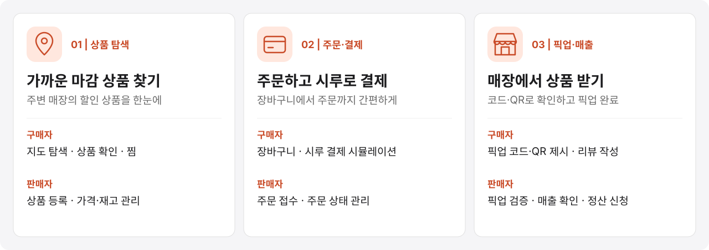
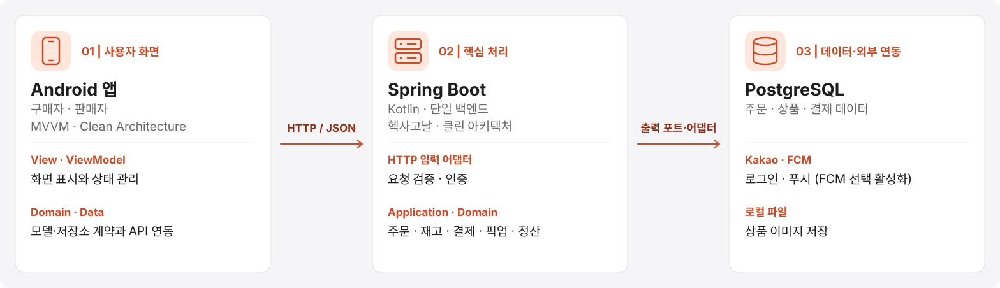
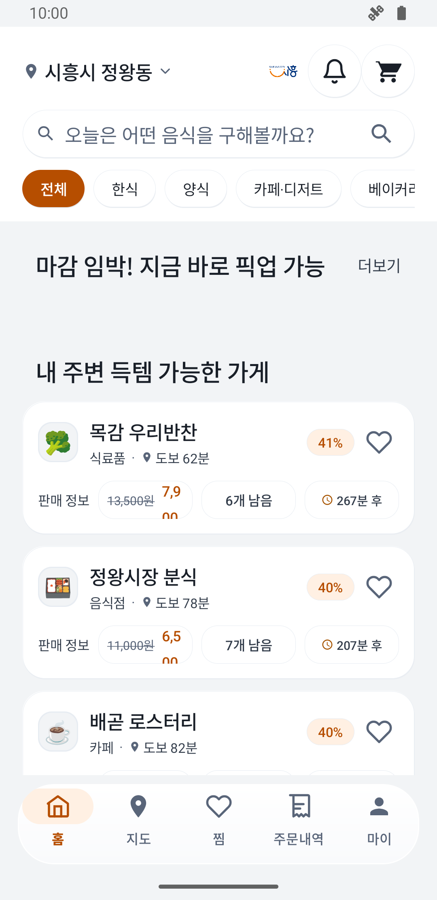
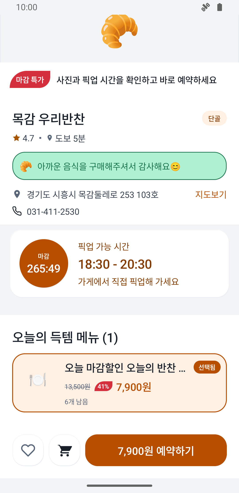
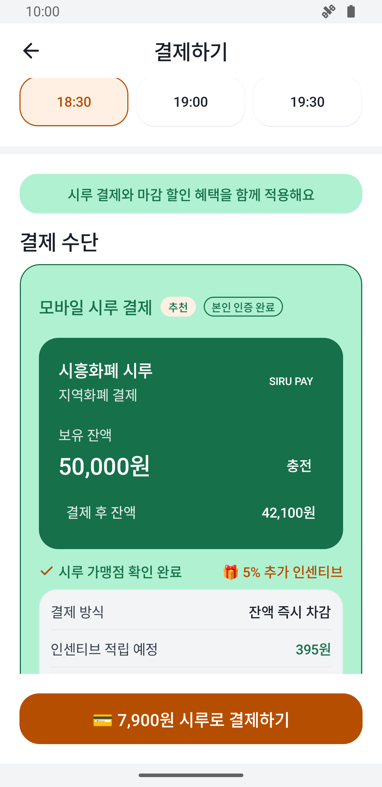
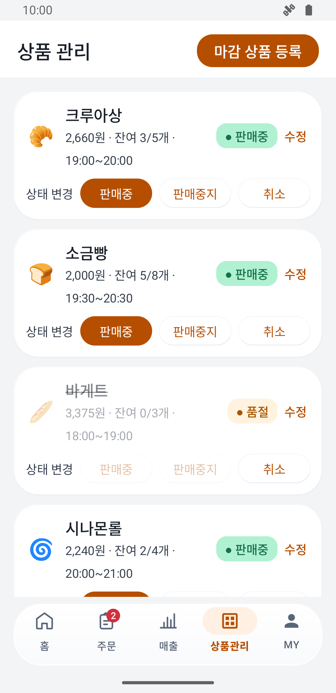
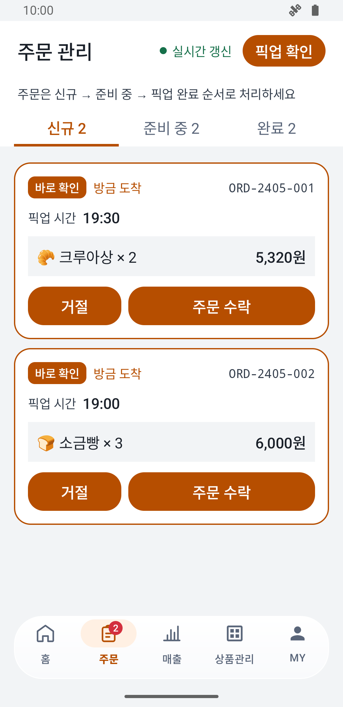
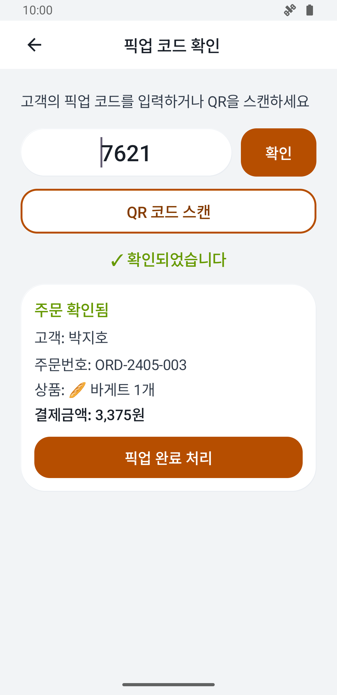
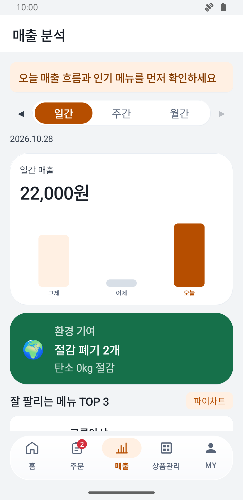
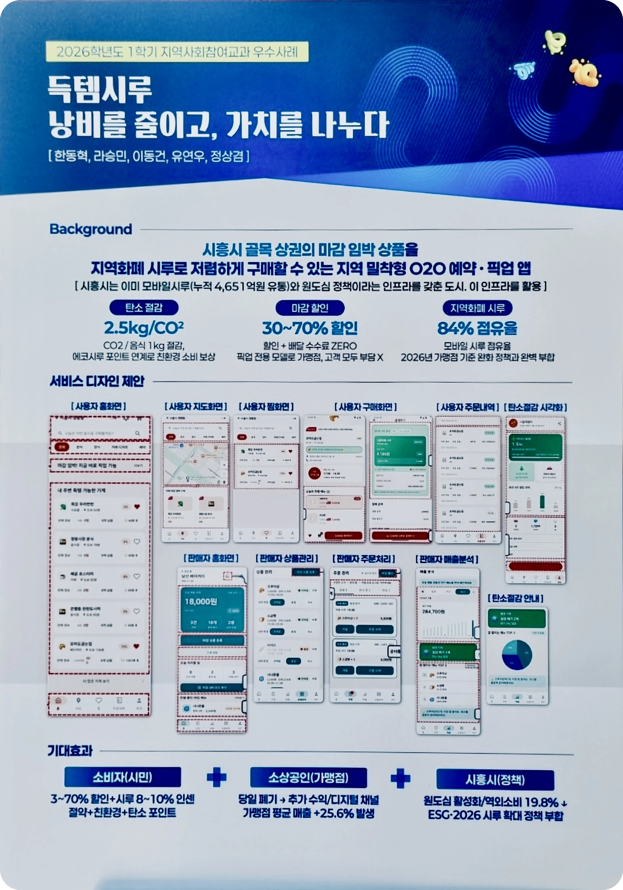

<h1 align="center">득템시루</h1>

  <b>오늘 팔리지 않으면 버려지는 상품을 가까운 소비자에게 빠르게 연결합니다</b> 
  시흥시 지역화폐 시루 기반 마감 할인 픽업 커머스 프로젝트

  
  
  
  

  <a href="https://github.com/deuktem-siru/backend">Backend</a> /
  <a href="https://github.com/deuktem-siru/android-app">Android</a>

---

## 핵심 기능

  

## 시스템 아키텍처

  

두 앱은 하나의 백엔드를 사용하며 PostgreSQL 트랜잭션으로 주문·정산 데이터의 정합성을 관리합니다. Prometheus·Grafana로 운영 상태를 확인합니다.

Android 코드는 [android-app](https://github.com/deuktem-siru/android-app) 저장소의 구매자 `buyer`·판매자 `seller`·공통 `common` 모듈로 통합했습니다. 인증·카카오 로그인·암호화 저장소·푸시 처리를 공유하며 앱은 각각 설치합니다.

백엔드는 헥사고날·클린 아키텍처의 유스케이스·출력 포트·어댑터로, Android는 MVVM·클린 아키텍처의 View·ViewModel·도메인·데이터 구현으로 분리합니다. JPA 매핑과 일부 기존 화면 렌더링은 유지합니다. 정확한 의존성 방향과 검사 범위는 [아키텍처 설계](../plan.md#아키텍처)를 참고하세요.

## 앱 화면

2026-10-28 현재 소스에서 구매자·판매자 Debug APK를 캐시 재사용 없이 다시 빌드·설치한 뒤 Android 에뮬레이터에서 실제 앱 화면 8장을 새로 촬영했습니다. 구매자 앱은 캡처 전용 로컬 개발 DB의 샘플 데이터와 시루 내부 잔액 시뮬레이션, 판매자 앱은 내장 `mock` 데모 모드를 사용했습니다.

탭 목록 대신 **탐색 → 상품 선택 → 결제 → 픽업**, **상품 관리 → 주문 수락 → 픽업 검증 → 매출 확인**의 핵심 흐름을 선정했습니다.

### 구매자 앱

| 주변 할인 매장 탐색 | 매장·상품·픽업 시간 | 시루 결제 | 주문 수락 후 픽업 |
| --- | --- | --- | --- |
|  |  |  |  |

### 판매자 앱

| 상품·재고 관리 | 신규 주문 수락 | 픽업 코드 검증 | 매출 분석 |
| --- | --- | --- | --- |
|  |  |  |  |

## 포스터

  

  

## 팀 구성

<table>
  <tr><td align="center"></td><td><b>한동혁</b> 팀장 · 프론트엔드</td><td>구매자 앱 (지도 SDK, 장바구니·찜, 경로 안내)</td></tr>
  <tr><td align="center"></td><td><b>정상겸</b> 기획 · 풀스택</td><td>구매자·판매자 앱 및 백엔드 연동, 테스트·모니터링, 문서 작성</td></tr>
  <tr><td align="center"></td><td><b>이동건</b> 풀스택 · 인프라</td><td>백엔드 ERD·API 설계, Kakao 로그인, AWS 배포</td></tr>
  <tr><td align="center"></td><td><b>유연우</b> 프론트엔드 · PPT</td><td>판매자 앱 (픽업 코드, 상품관리·고객 알림), 발표 자료</td></tr>
  <tr><td align="center"></td><td><b>라승민</b> 프론트엔드</td><td>구매자 앱 (UI)</td></tr>
</table>
