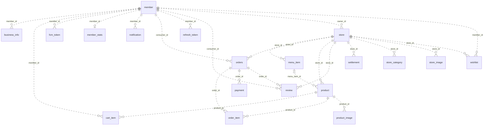

# 데이터 모델 — 득템시루

[문서 안내](../README.md#관련-문서)

## 기준과 범위

이 문서는 데이터 관계, 저장하는 값의 의미, 무결성 규칙을 설명한다. 컬럼 타입·nullable·열거형 전체 목록은 다음 원본을 확인한다.

- [JPA 엔티티](https://github.com/deuktem-siru/backend/tree/main/src/main/kotlin/com/deuktemsiru/domain): 전체 모델과 매핑. 엔티티 생성자 초기값은 DB `DEFAULT`와 구분한다.
- [Flyway SQL](https://github.com/deuktem-siru/backend/tree/main/src/main/resources/db/migration): 기존 스키마에 적용하는 변경과 제약.
- [운영 설정](https://github.com/deuktem-siru/backend/blob/main/src/main/resources/application-prod.properties): 기본 `ddl-auto=validate`, Flyway 활성. 개발 기본값은 `create-drop`, Flyway 비활성이다.

현재 V1~V5는 기존 DB 변경분이며 초기 스키마 생성 SQL이 없다. Flyway만으로 빈 운영 DB를 구성할 수 없으며, 엔티티와 SQL을 함께 확인해야 한다. 초기 배포는 [DB 준비 절차](deploy.md#배포-전-db-준비)를 따른다. 아래 관계도는 JPA 선언 기준으로, 운영 DB를 직접 조회한 결과가 아니다.

## 관계도

JPA에 선언된 FK 관계. `||`=1개, `o|`=0~1개, `o{`=0개 이상. 모든 테이블이 독립 PK를 가지므로 비식별 관계(`..`)다.

`notification.related_*_id`는 FK 없는 ID 컬럼이라 제외했다. `payment.order_id`는 유일하지 않아 주문 하나에 결제·환불이 여러 건 붙는다. `business_info`는 회원에만 연결되고 매장과 직접 연결되는 FK는 없다.

## 데이터 흐름과 저장 의미

- **메뉴와 상품:** `menu_item`은 상시 메뉴, `product`는 판매일·재고·픽업 시간대가 있는 판매 단위다. 메뉴 참조는 선택이므로 직접 입력 상품도 가능하다. 이미지와 매장 카테고리는 별도 행으로 저장한다.
- **장바구니와 주문:** 장바구니는 구매 후보이며 재고 예약이 아니다. 주문 생성 시 `orders`와 `order_item`을 만들고 재고를 차감한다. `order_item.unit_price`는 주문 당시 단가를 보존한다. 주문 생성으로 장바구니 행을 자동 삭제하지 않는다.
- **결제와 환불:** 주문에 결제·환불 행이 여러 개 연결된다. 시루는 `member.siru_balance`를 차감·복원하는 내부 시뮬레이션이다. `external_transaction_id`도 내부 생성값이다. 취소 시 `REFUNDED` 행을 추가한다.
- **정산:** `settlement`는 매장·기간별 정산 기록이며 `payment`와 직접 FK가 없다. 지급 완료 시 `settled_at`을 기록한다. 집계 기준·수수료·상태 전이와 수기 송금 범위는 [정산 기준](../spec.md#매출과-알림)을 따른다.
- **집계:** 매장 평점·리뷰 수와 회원 누적 통계는 저장값이다. 상품 할인율과 장바구니 합계는 계산값이며 별도 컬럼이 없다.
- **회원과 인증:** 탈퇴는 계정 비활성화와 시각 기록이다. 리프레시 토큰은 폐기 여부를 저장하고, FCM 토큰은 회원별 여러 기기를 지원한다. 로그아웃 동작은 [API 기준](../spec.md#회원과-권한)을 따른다.
- **알림:** 수신자는 회원 FK지만 `related_*_id`는 FK 없는 참조 ID다. 알림 설정 필드와 실제 이벤트 종류는 일대일 대응하지 않는다.

## 무결성과 삭제 경계

| 저장소가 표현하는 제약 | 의미 |
| --- | --- |
| `member_stats.member_id` UNIQUE | 회원별 통계 최대 1행 |
| `business_info.business_number`, `fcm_token.token`, `orders.pickup_code` UNIQUE | 사업자 번호·기기 토큰·픽업 코드 중복 방지 |
| `cart_item(member_id, product_id)` UNIQUE | 회원별 동일 상품은 한 장바구니 행 |
| `review(consumer_id, order_id)` UNIQUE | 회원·주문별 리뷰 최대 1행 |
| `wishlist(member_id, store_id)` UNIQUE | 찜은 상품이 아닌 매장 단위 |

회원 이메일·닉네임·소셜 ID와 매장 소유자 ID에는 UNIQUE가 없다. 서비스가 기대하는 유일성을 DB가 보장한다고 가정하지 않는다.

`Orders.items`, `Product.images`, `Store.categories/images/menuItems/products`의 `cascade=ALL`·`orphanRemoval=true`는 JPA 동작이며 DB `ON DELETE CASCADE`가 아니다. 메뉴는 비활성화, 상품은 `DELETED`, 리뷰는 논리 삭제로 처리한다. 논리 삭제는 UNIQUE 제약을 제거하지 않는다.

서비스의 상태 전이와 소유권 검사는 [현재 업무 규칙](../spec.md#현재-업무-규칙)을 따른다.

## 변경할 때

컬럼과 관계 변경은 JPA 매핑과 새 Flyway 마이그레이션에 반영한다. 이미 적용한 SQL은 수정하지 않는다. 이 문서는 관계·저장 의미·무결성 경계가 바뀔 때 갱신하고, API에서 보이는 동작 변경은 요구사항와 관련 앱에 함께 반영한다. 배포 순서와 DB 준비는 [배포 문서](deploy.md)를 확인한다.

## 관련 문서

- [요구사항](../spec.md): 제품 범위·완료 기준
- [배포 가이드](deploy.md): 운영 설정·배포·점검
